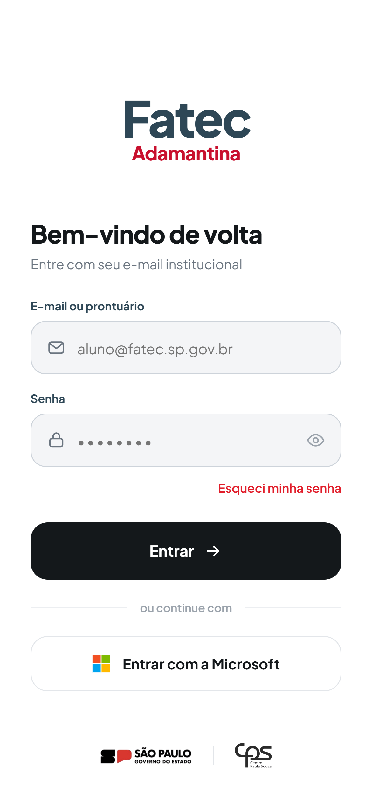
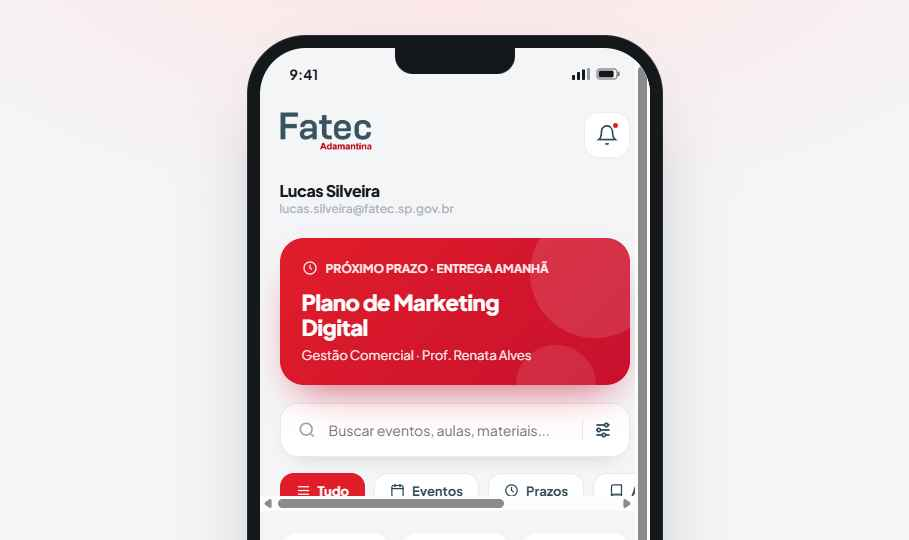

<div align="center">

# 🎓 Hub Acadêmico · Fatec Adamantina

Um app para a rotina de alunos, professores e coordenação da Fatec Adamantina:
grade, prazos, materiais, entregas, eventos, avisos e frequência num lugar só.



&nbsp;&nbsp;


</div>

## 💡 Por quê

A ideia é substituir o Teams na rotina do estudante por algo mais simples, e
cobrir o que o Teams não cobre: **central de avisos, horário e frequência**. O hub
é a origem do dado: o que a coordenação cadastra é o que alunos e professores veem.

## 📍 Estado atual

Este repositório é o **protótipo de design em alta fidelidade**: telas navegáveis
em HTML/CSS/JS feitas no Claude Design, com dados fictícios. Ainda **não há app
publicado nem back-end**. As telas são a referência visual e de comportamento para
a implementação real.

## 📱 Telas

| Papel | Telas |
|---|---|
| **Aluno** (app) | Abertura, onboarding (3), login, home (próximo prazo, aulas de hoje, eventos), cronograma da semana, calendário, eventos, atividades com filtros, detalhe com entrega de trabalho, materiais (curso → termo → matéria), lembretes, perfil e frequência |
| **Professor** (app) | Minhas turmas, turma aberta, entregas da atividade, avaliar entrega, nova atividade, publicar material e chamada |
| **Coordenação** (painel web) | Visão geral, avisos com público-alvo, eventos e inscritos, usuários e papéis, estrutura acadêmica, turmas e grade, matrículas e auditoria |

## 🧭 Decisões de produto

- **Tudo é auditável**: toda alteração fica registrada com autor, e excluir vira arquivar.
- **A coordenação vem primeiro**: é ela que cadastra cursos, turmas e matrículas.
- **A chamada é feita no app** pelo professor. A média mostrada é só das atividades do hub, não o boletim oficial.
- **Todo aviso tem público-alvo** definido.
- **A cor indica o papel**: vermelho `#E11D2A` para o aluno e slate `#2E4756` para professor e coordenação.
- **Acessibilidade WCAG 2.1 AA**: os cinzas do protótipo original que reprovavam em contraste foram trocados, e as áreas de toque têm no mínimo 44px no app.

## 🛠️ Tecnologias

| | |
|---|---|
| **Protótipo** (este repositório) | HTML/CSS/JS no formato Design Component (`.dc.html`), React 18 e Babel via CDN, fonte Plus Jakarta Sans |
| **Planejado** | App em **Expo (React Native)** para aluno e professor, Android e iOS do mesmo código, e **painel web** para a coordenação, consumindo a mesma API. Back-end, banco e login ainda em definição (a recomendação é entrar com a conta Microsoft institucional) |

## 📁 Estrutura

```
PRODUCT.md                   # contexto do produto: usuários, propósito, decisões
fatec-adamantina-app/        # protótipo original do app do aluno (Claude Design)
└── project/                 # telas, logos, ilustrações e prints
design/                      # telas novas, em formato .dc.html
├── aluno/                   # frequência
├── professor/               # 7 telas
└── coordenacao/             # 8 telas do painel web
docs/auditoria.html          # auditoria de completude, segurança e acessibilidade
```

Detalhes do sistema visual e das regras das telas em [`design/README.md`](design/README.md).

## 🗺️ Próximos passos

- [ ] Definir back-end, banco e hospedagem
- [ ] Confirmar o login com a conta Microsoft institucional
- [ ] Implementar o painel da coordenação (é ele que alimenta o resto)
- [ ] Implementar o app em Expo a partir destas telas
- [ ] Revisar o tratamento de dados pessoais (LGPD)
